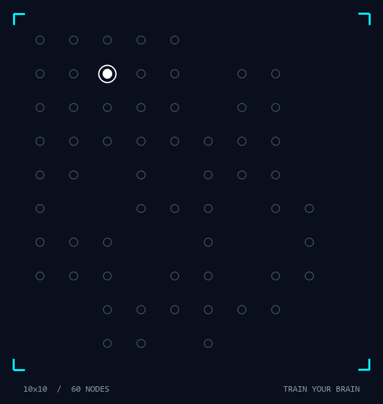
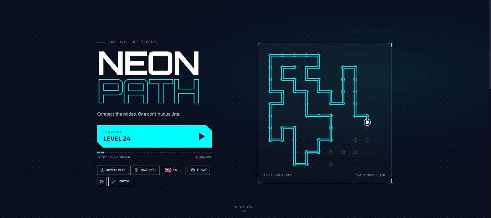
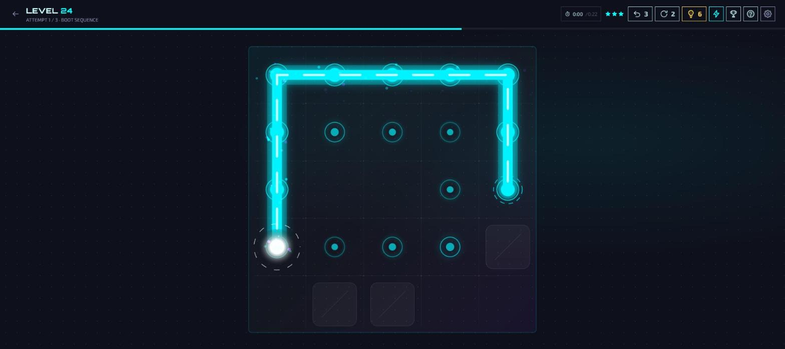
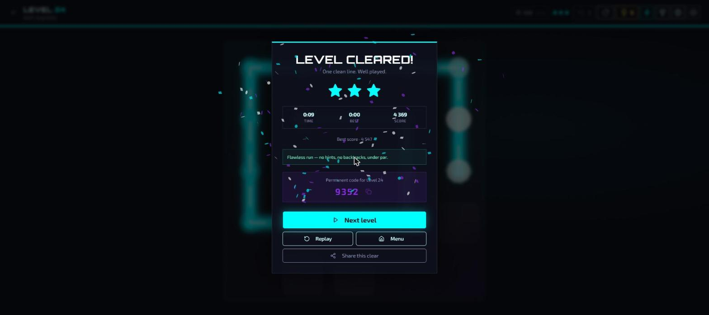
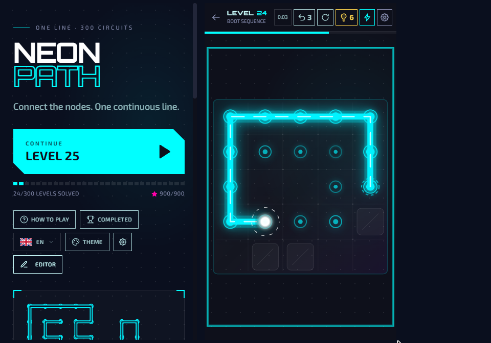

<div align="center">

# 🎮 NEON PATH PUZZLE

[](https://nrn-world.github.io/NeonPathPuzzle/)
[](https://neon-path-puzzle-nrnworld.vercel.app)
[](LICENSE)
[](https://reactjs.org/)
[](https://www.typescriptlang.org/)

**A cyber-logic puzzle game where you connect all nodes with a single continuous line.**



🔥 **300 Unique Levels** | 💥 **Forgiving by default · opt-in Hardcore** | ⭐ **Chapter Map & Stars** | 🗓️ **Single-solution daily boards** | 🎨 **10 Neon Themes (4 seasonal)** | 📱 **Mobile Ready**

</div>

---

## 🎮 Game Preview

<table>
  <tr>
    <td width="50%">
      <h3 align="center">🏠 Main Menu</h3>
      
    </td>
    <td width="50%">
      <h3 align="center">🎯 Gameplay</h3>
      
    </td>
  </tr>
  <tr>
    <td width="50%">
      <h3 align="center">🏆 Level Complete</h3>
      
    </td>
    <td width="50%">
      <h3 align="center">📱 Mobile</h3>
      
    </td>
  </tr>
</table>

---

## ✨ Features

- 🗺️ **World map & story** - every chapter opens with a short terminal briefing, and the map shows where you are
- 🌀 **The Rift** - 30 bonus levels after the campaign with new rules: phase diamonds (even/odd positions) and flip arrows
- 📈 **Profile** - rank progress, 12-week activity calendar, chapter progress and fastest clears
- 🎉 **Seasonal events** - spring, summer, Halloween and winter events that earn a permanent theme
- 🏆 **Online rankings** (optional) - daily, weekly and star boards, results verified by replaying your line
- ♿ **Accessibility** - colour-blind palette, large text, pinch zoom, gamepad support, a screen-readable board description, reduced motion
- 📳 **Haptics** - distinct patterns for steps, milestones, wins and crashes
- 🎯 **300 Unique Levels** - Progressive difficulty across 12 chapters, with walls, one-way nodes, ordered color pairs, portals, sync nodes, blackout boards and boss levels — every one proven solvable by the test suite
- 💥 **Forgiving progression** - Unlimited attempts by default, and closing the app never costs you levels. Turn on **Hardcore** in Settings for three attempts and the classic system crash (stars and records are always kept)
- 🎵 **Procedural Sound Effects** - Layered step notes that rise with your progress, a win chime, dead-end and crash effects, all synthesised live (no audio files)
- ⭐ **Stars, best times & best scores** - Three stars for a clean line: no hints, no backtracks, no dead ends. Time affects score and rankings, not stars
- 👻 **Personal best ghost** - Race a faint trace of your fastest run
- 🗓️ **Daily & weekly challenges** - Dedicated, provably single-solution boards that never repeat within 72 days/weeks, a rotating weekly modifier, par-normalised pace scores and shareable cards
- 🧘 **Zen practice** - Replay any unlocked level without a timer or records
- 💡 **Progressive hints** - A free one-step nudge, then three steps, then the full line. Each hint is computed from your current line by a real solver; deeper hints cost tokens
- 🎨 **5 Unlockable Neon Themes** - Cyberpunk, Retro Wave, Cosmic, Matrix, Neon Sunset
- ⚡ **4 Strategic Power-ups** - Time Freeze, Path Reveal, Undo Shield, Score Boost
- 🏆 **Achievement System** - Unlock 10+ achievements as you progress
- 💾 **Level Code System** - Jump to any level with permanent 4-digit codes
- ☁️ **Save backup** - Export and restore progress, achievements, power-ups, tokens and themes as JSON
- ⚙️ **Settings & Accessibility** - Sound, haptics, reduced motion, ghost toggle, keyboard shortcuts, auto-pause
- 🌍 **English, Svenska, Türkçe and Español** - English by default; UI, level messages and the privacy page are translated. Your choice is remembered on each device
- 🧪 **Circuit Lab** - Draw your own board, get live proof of *exactly one solution* plus a difficulty score, play it and share a short link. Works offline, no account
- 👻 **Rival ghost** - Copy a challenge link with your board, line and time; a friend races a real-time ghost with a live pace delta, a verdict and a scannable QR code
- 🌅 **Daily ritual** - Full-screen board reveal, 30-day calendar, countdown and streak shields that forgive one missed day
- 👑 **Boss set pieces** - Every 25th level combines rule families early, opens with its own briefing and wears a chapter-coloured frame
- 🎬 **Cinematic power surge** - Slow camera push, reverse light pulse, chapter shockwave, haptic thud and resolve chord before the result card
- 🎼 **12 chapter soundtracks** - Each chapter has its own root, scale, chord and phrase length
- 🔍 **Diagnostics & a11y** - See/export/erase your opt-in local event log; CI runs axe WCAG scans and visual-regression screenshots
- 📲 **Installable & offline** - PWA manifest plus a service worker, and an "Add to home screen" prompt
- 📱 **Fully Responsive** - Play on desktop, tablet, or mobile

---

## 🚀 Live Demo

### **[🎮 Play on GitHub Pages - https://nrn-world.github.io/NeonPathPuzzle/](https://nrn-world.github.io/NeonPathPuzzle/)**

---

## 📖 How to Play

1. **🎯 Objective**: Connect all nodes with a single continuous line
2. **📍 Rules**: Visit each node exactly once, path cannot cross itself
3. **↩️ Undo**: Backtracks are free; they only cost a star, never a life
4. **⭐ Stars**: Finish without hints, without backtracks and without dead ends — take all the time you need
5. **🔓 Progression**: Complete levels sequentially or use codes to jump ahead

---

## 🛠️ Tech Stack

<div align="center">

[](https://reactjs.org/)
[](https://www.typescriptlang.org/)
[](https://tailwindcss.com/)
[](https://vitejs.dev/)
[](https://www.framer.com/motion/)
[](https://nodejs.org/)

</div>

---

## 🏁 Getting Started

### Prerequisites
- Node.js 18+ 
- npm or yarn

### Installation

```bash
# Clone the repository
git clone https://github.com/RobinAyzit/NeonPathPuzzle.git

# Navigate to project directory
cd NeonPathPuzzle

# Install dependencies
npm install

# Start development server
npm run dev
```

The game will be available at `http://localhost:5000`

### Build for Production

```bash
npm run build
```

---

## 📄 License

MIT License

Copyright (c) 2026 nRn World

Permission is hereby granted, free of charge, to any person obtaining a copy
of this software and associated documentation files (the "Software"), to deal
in the Software without restriction, including without limitation the rights
to use, copy, modify, merge, publish, distribute, sublicense, and/or sell
copies of the Software, and to permit persons to whom the Software is
furnished to do so, subject to the following conditions:

The above copyright notice and this permission notice shall be included in all
copies or substantial portions of the Software.

THE SOFTWARE IS PROVIDED "AS IS", WITHOUT WARRANTY OF ANY KIND, EXPRESS OR
IMPLIED, INCLUDING BUT NOT LIMITED TO THE WARRANTIES OF MERCHANTABILITY,
FITNESS FOR A PARTICULAR PURPOSE AND NONINFRINGEMENT. IN NO EVENT SHALL THE
AUTHORS OR COPYRIGHT HOLDERS BE LIABLE FOR ANY CLAIM, DAMAGES OR OTHER
LIABILITY, WHETHER IN AN ACTION OF CONTRACT, TORT OR OTHERWISE, ARISING FROM,
OUT OF OR IN CONNECTION WITH THE SOFTWARE OR THE USE OR OTHER DEALINGS IN THE
SOFTWARE.

---

##  Contact & Support

👨‍💻 **Author**  
Created 2026 by © nRn World

📧 bynrnworld@gmail.com

## 🙏 Support

If you like this project, consider:

* ⭐ Star the project on GitHub  
* ☕ **Support development**: [Buy me a coffee 💜](https://ko-fi.com/nrnworld)  
* 📢 Share with your friends

Created by ❤️ © nRn World
