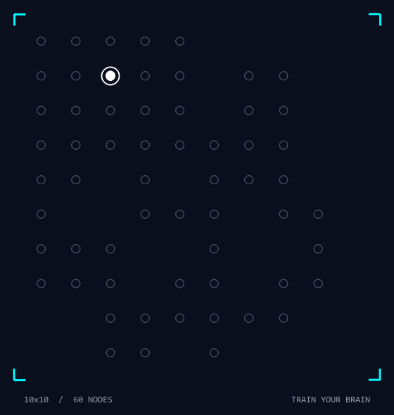
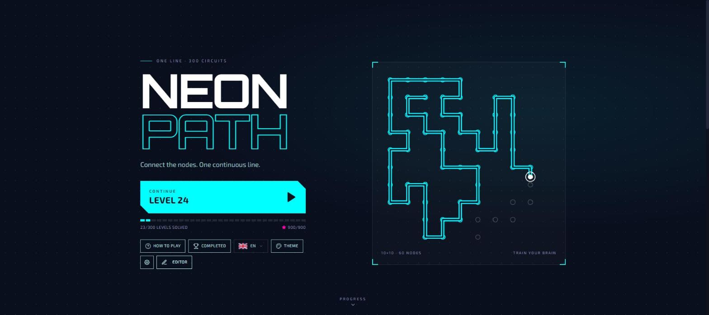
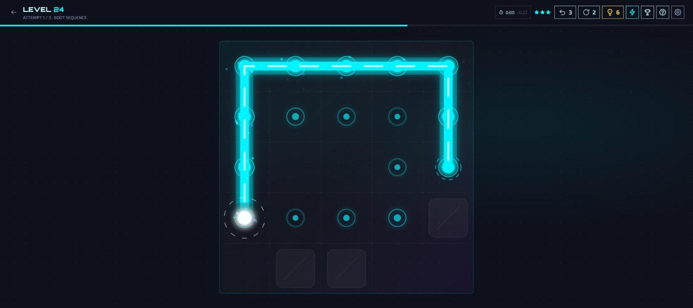
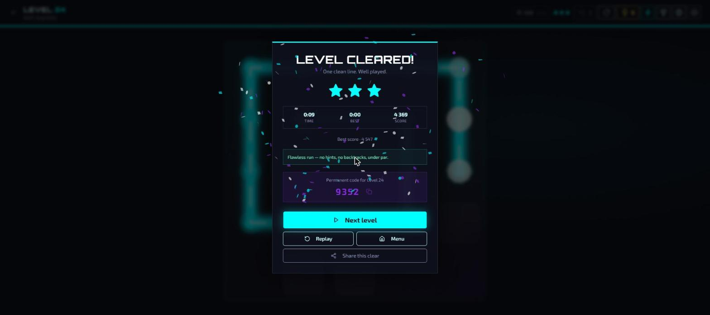

<div align="center">

# 🎮 NEON PATH PUZZLE

[](https://nrn-world.github.io/NeonPathPuzzle/)
[](https://neon-path-puzzle-nrnworld.vercel.app)
[](LICENSE)
[](https://reactjs.org/)
[](https://www.typescriptlang.org/)

**A cyber-logic puzzle game where you connect all nodes with a single continuous line.**



🔥 **300 Unique Levels** | 💥 **3 Attempts or Crash** | ⭐ **Chapter Map & Stars** | 🗓️ **Daily Challenge** | 🎨 **6 Neon Themes** | 📱 **Mobile Ready**

</div>

---

## 🎮 Game Preview

<table>
  <tr>
    <td width="50%">
      <h3 align="center">🏠 Main Menu</h3>
      
    </td>
    <td width="50%">
      <h3 align="center">🎯 Gameplay</h3>
      
    </td>
  </tr>
  <tr>
    <td width="50%">
      <h3 align="center">🏆 Level Complete</h3>
      
    </td>
    <td width="50%">
      <h3 align="center">🎨 Themes</h3>
      
    </td>
  </tr>
</table>

---

## ✨ Features

- 🎯 **300 Unique Levels** - Progressive difficulty across 12 chapters, with walls, one-way nodes, ordered color pairs, portals, sync nodes, blackout boards and boss levels — every one proven solvable by the test suite
- 💥 **Three Attempts** - Two restarts per new level; fail the third and the system crashes back to level 1 (stars and records are kept)
- 🎵 **Procedural Sound Effects** - Layered step notes that rise with your progress, a win chime, dead-end and crash effects, all synthesised live (no audio files)
- ⭐ **Stars, best times & best scores** - Chase three-star clears without losing lives
- 👻 **Personal best ghost** - Race a faint trace of your fastest run
- 🗓️ **Daily & weekly challenges** - One seeded puzzle per day plus a rotating weekly modifier and shareable cards
- 🧘 **Zen practice** - Replay any unlocked level without a timer or records
- 💡 **Hint tokens** - Spend a token instead of a star; earn more from challenges and achievements
- 🎨 **5 Unlockable Neon Themes** - Cyberpunk, Retro Wave, Cosmic, Matrix, Neon Sunset
- ⚡ **4 Strategic Power-ups** - Time Freeze, Path Reveal, Undo Shield, Score Boost
- 🏆 **Achievement System** - Unlock 10+ achievements as you progress
- 🛠️ **Level editor** - Draw your own circuits and share them as links
- 💾 **Level Code System** - Jump to any level with permanent 4-digit codes
- ☁️ **Save backup** - Export and restore progress, achievements, power-ups, tokens and themes as JSON
- ⚙️ **Settings & Accessibility** - Sound, haptics, reduced motion, ghost toggle, keyboard shortcuts, auto-pause
- 🌍 **English, Svenska, Türkçe and Español** - English by default; your choice is remembered on each device (language picker with flags on the title screen and in Settings)
- 📲 **Installable & offline** - PWA manifest plus a service worker for offline play
- 📱 **Fully Responsive** - Play on desktop, tablet, or mobile

---

## 🚀 Live Demo

### **[🎮 Play on GitHub Pages - https://nrn-world.github.io/NeonPathPuzzle/](https://nrn-world.github.io/NeonPathPuzzle/)**

---

## 📖 How to Play

1. **🎯 Objective**: Connect all nodes with a single continuous line
2. **📍 Rules**: Visit each node exactly once, path cannot cross itself
3. **↩️ Undo**: Backtracks are free; they only cost a star, never a life
4. **⭐ Stars**: Finish without hints, without backtracks, and under par time
5. **🔓 Progression**: Complete levels sequentially or use codes to jump ahead

---

## 🛠️ Tech Stack

<div align="center">

[](https://reactjs.org/)
[](https://www.typescriptlang.org/)
[](https://tailwindcss.com/)
[](https://vitejs.dev/)
[](https://www.framer.com/motion/)
[](https://nodejs.org/)

</div>

---

## 🏁 Getting Started

### Prerequisites
- Node.js 18+ 
- npm or yarn

### Installation

```bash
# Clone the repository
git clone https://github.com/RobinAyzit/NeonPathPuzzle.git

# Navigate to project directory
cd NeonPathPuzzle

# Install dependencies
npm install

# Start development server
npm run dev
```

The game will be available at `http://localhost:5000`

### Build for Production

```bash
npm run build
```

---

## 📄 License

MIT License

Copyright (c) 2026 nRn World

Permission is hereby granted, free of charge, to any person obtaining a copy
of this software and associated documentation files (the "Software"), to deal
in the Software without restriction, including without limitation the rights
to use, copy, modify, merge, publish, distribute, sublicense, and/or sell
copies of the Software, and to permit persons to whom the Software is
furnished to do so, subject to the following conditions:

The above copyright notice and this permission notice shall be included in all
copies or substantial portions of the Software.

THE SOFTWARE IS PROVIDED "AS IS", WITHOUT WARRANTY OF ANY KIND, EXPRESS OR
IMPLIED, INCLUDING BUT NOT LIMITED TO THE WARRANTIES OF MERCHANTABILITY,
FITNESS FOR A PARTICULAR PURPOSE AND NONINFRINGEMENT. IN NO EVENT SHALL THE
AUTHORS OR COPYRIGHT HOLDERS BE LIABLE FOR ANY CLAIM, DAMAGES OR OTHER
LIABILITY, WHETHER IN AN ACTION OF CONTRACT, TORT OR OTHERWISE, ARISING FROM,
OUT OF OR IN CONNECTION WITH THE SOFTWARE OR THE USE OR OTHER DEALINGS IN THE
SOFTWARE.

---

##  Contact & Support

👨‍💻 **Author**  
Created 2026 by © nRn World

📧 bynrnworld@gmail.com

## 🙏 Support

If you like this project, consider:

* ⭐ Star the project on GitHub  
* ☕ **Support development**: [Buy me a coffee 💜](https://ko-fi.com/nrnworld)  
* 📢 Share with your friends

Created by ❤️ © nRn World
